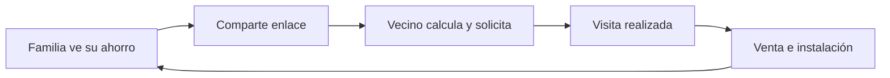

# Sol de Casa · ficha de growth · Parte 2

**Caso educativo; proyecciones y registros de interfaz: SIMULADO.** Referencias: [plan de Parte 2](plan-parte-2-sol-de-casa.md) y [modelo financiero auditado de Parte 1](sol-de-casa-nivel-1-modelo.md).

**Ciclo dibujado**

**Fuga actual.** De 100 visitas web, 14 abren el formulario y 6 lo envían. **El 86 % se pierde antes de abrirlo.** La tarjeta pone el ahorro al principio y pide datos después del cálculo.

**Retención.** Consiste en mantener la relación después de instalar mediante el ahorro visible, las recomendaciones y el mantenimiento. Métrica semanal del piloto: hogares únicos que ven o intentan compartir su ahorro por cada 100 hogares invitados. Abrir WhatsApp cuenta como intención de compartir.

**Prueba A/B [SUPUESTO].** Asignar al azar 25 familias a la experiencia y 25 al proceso actual durante 30 días. La línea base mensual se medirá en el control. Meta direccional: **al menos 4 leads referidos trazables** entre las 25 tratadas y superar al control. Contramétrica: **asistencia a visitas ≥90 %**, con CAC referido ≤$300 y agendas dentro de capacidad.

**Costo y capacidad.** Con 45 % de cierre sobre visitas realizadas, una venta requiere `1 ÷ 0,45 = 2,222…` visitas. A $60 por visita son **$133,33 por venta**; quedan **$166,67** para premios bajo el tope de $300. Los incentivos propuestos suman `$15 ÷ 0,45 + $50 = $83,33` por venta [SUPUESTO]. **CAC referido proyectado = $216,67**, con redondeo solo al presentar. El CAC pagado combinado del escenario «Hoy» de Parte 1 es **$620,59**; incluye anuncios y visitas realizadas, mientras el referido proyectado incluye visitas y premios. Son bases diferentes, no un resultado observado del piloto.

| Evento | Premio [SUPUESTO] | Regla |
| --- | ---: | --- |
| Compartir, solicitar o agendar | $0 | Solo avance |
| Visita realizada | $15 para quien refirió | Una vez por visita |
| Venta cerrada | $50 para el nuevo cliente | Una vez por cierre |

**Capacidad para 50 visitas adicionales al mes.** Si 95 % llega a contacto, 85 % agenda y 90 % asiste, hacen falta **69 leads al mes**, unos **138 en dos meses**. A 6 leads por cada 20 hogares en dos meses, harían falta **459 familias que compartan** [SUPUESTO], calculadas sin redondear los leads intermedios. Las 420 familias instaladas aportarían unas **45,8 visitas al mes** a ese ritmo. El letrero es una referencia, y el piloto debe medir la conversión digital. De las 100 plazas mensuales del caso, la pauta actual usa 97,49 en la proyección.

| Cuadrante | Canal en 90 días | Decisión y medida |
| --- | --- | --- |
| Alto potencial / bajo costo marginal | Tarjeta y mensaje postinstalación [SUPUESTO] | Probar con 25 familias; medir leads, visitas y CAC |
| Alto impacto / alto costo | Meta y Google pagados | Optimizar CAC por canal y capacidad |
| Complemento / costo bajo esperado [SUPUESTO] | Publicación orgánica con permiso | Apoyar tarjetas; atribuir enlaces |
| Impacto y costo por validar | Letreros de barrio | Repetir en pequeño; medir costo y cierres |

**Error de IA detectado en Parte 2.** La versión inicial llamaba a `crypto.randomUUID()` al abrir la invitación. En HTTP fuera de localhost esa función puede faltar y la página fallaba al renderizar. Se agregó una alternativa con `getRandomValues()` y una prueba de regresión que renderiza la ruta con esa API limitada.
